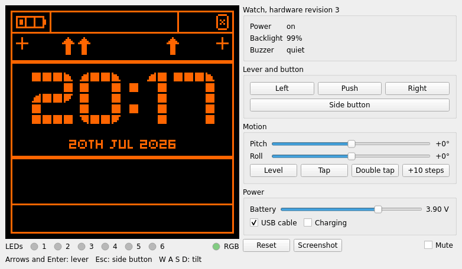
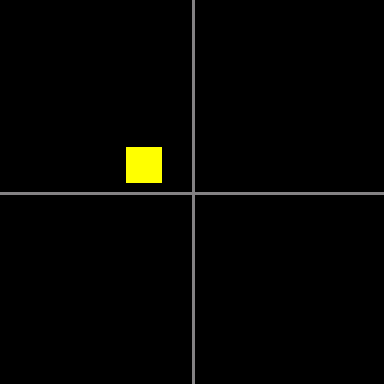
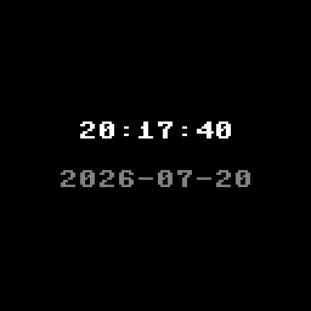

# Artemis Watch emulator

An emulator for the [CircuitMess NASA Artemis Watch 2.0](https://circuitmess.com/products/nasa-artemis-watch-2-0). It runs the watch's real, unmodified firmware on your computer: a dual-core ESP32-S3 in QEMU, with the display, lever, button, LEDs, buzzer, motion sensor, clock and battery around it.

<p align="center">
  
</p>

## Features

- **Runs what the watch runs.** CircuitMess's stock firmware (2.0 to 2.2), their MicroPython, or a firmware you built with ESP-IDF.
- **The whole watch.** Display, inputs, LEDs and buzzer, motion sensor, real-time clock, battery and charging, sleep, watchdogs and flash. Bluetooth and Wi-Fi start, with nobody to talk to.
- **The chip's timing.** Code takes as long as it does on the watch, to within a few percent, and sleeps and timers are right to microseconds.
- **Checked against hardware.** The same tests pass on the emulator and on a real watch.
- **Scriptable.** A Python API works the watch and reads its display, LEDs and serial output, for automated tests. There's a headless mode, screenshots and a GDB stub.
- **Works with a real watch too.** Back it up, flash it, restore it, and run the same program on it.

## Quick start

On x86-64 Linux, or Windows through WSL, with Python 3.10 or later:

```sh
git clone https://github.com/ThatCrispyToast/circuitmess-artemis-emulator
cd circuitmess-artemis-emulator
python3 -m venv .venv && . .venv/bin/activate
pip install .

artemis-emu stock                      # CircuitMess's factory firmware
artemis-emu python examples/hello.py   # a MicroPython program
artemis-emu repl                       # a MicroPython prompt (Ctrl-] quits)
artemis-emu run firmware.bin           # a firmware you built
```

QEMU and the firmware are downloaded on first use. [docs/install.md](docs/install.md) covers system packages, Windows, Nix and building from source; [docs/usage.md](docs/usage.md) has every option and key.

## Your own programs

<p align="center">
  
  
  
</p>

MicroPython programs use CircuitMess's `Artemis` library, as they do on the watch; the ones above are in [`examples/`](examples). `--install` stores a script as `main.py`, so that it runs at every boot the way a program from CircuitBlocks does:

```sh
artemis-emu python my_program.py --install --flash my_watch.bin
```

## With a real watch

Plug the watch in over USB:

```sh
artemis-emu device info                        # chip, revision, and what firmware it's running
artemis-emu device backup my-watch.bin         # save its whole flash, and do this first
artemis-emu device flash micropython           # put this project's MicroPython on it
artemis-emu python examples/hello.py --device  # run a program on the watch
artemis-emu device restore my-watch.bin        # exactly as it was
```

More, including the udev rule your user needs, in [docs/usage.md](docs/usage.md#with-a-real-watch).

## Testing your code

```python
from artemis_emu import PythonSession, Watch, micropython_firmware

def test_lever_push_lights_an_led():
    with Watch(micropython_firmware()) as watch:
        session = PythonSession(watch)
        session.start(open("examples/hello.py").read())
        watch.wait_until(lambda: (255, 255, 255) in watch.pixels())

        watch.press("select", 0.15)
        watch.wait_until(lambda: watch.leds[0] == 1.0, timeout=2)
```

A test presses buttons, tilts the watch, changes the battery, and looks at pixels, LEDs, the buzzer and serial output. `pip install '.[test]'` adds pytest. A `PythonSession` works the same on a `Device`, a real watch on USB, so a test of what your code prints can run on hardware too. The API is in [docs/testing.md](docs/testing.md).

## Accuracy

The emulator is held to measurements taken on a watch; `tests/test_like_a_watch.py` runs on either.

| | Emulator against the watch |
| --- | --- |
| Speed of code | 17 of 27 MicroPython operations within 3%, all within 11% |
| Sleeps and timers | within microseconds, and UART and PWM keep their rates |
| Registers | 1994 of 2004 compared read the same |
| Resets and watchdogs | same causes, same timing, same state left behind |

What is emulated and how it was measured are in [docs/accuracy.md](docs/accuracy.md).

## Limitations

- Nothing goes on the air. Bluetooth and Wi-Fi start but never connect, so pairing with a phone can't be tested.
- Turning Wi-Fi off takes five seconds, where a watch takes milliseconds.
- Memory-heavy work runs up to 15% fast, since flash and PSRAM never miss the cache.
- In a virtual machine, WSL included, code that works a peripheral hard runs up to a third slow.
- Keeping the chip's timing takes about one core of your computer while the watch is busy.
- The ULP coprocessor, USB OTG, TWAI, motor PWM, SD host, camera and LCD interfaces do nothing.
- The ADC reads ideal voltages, the buzzer is a square wave, and nothing draws current.
- The published QEMU is for x86-64 Linux with glibc 2.34 or later. Anywhere else, build it from source.
- Rebuilding the MicroPython image takes Nix.
- Using a real watch from WSL needs usbipd-win, and hasn't been tried.

## How it works

[Espressif's QEMU fork](https://github.com/espressif/qemu) emulates the ESP32-S3. This project adds the watch's devices and the parts of the chip that fork lacks, paces the CPUs to the chip's speed, and puts a Python front end, window and test API on top. Both firmwares are fetched or built by the flake, at pinned versions. See [docs/internals.md](docs/internals.md).

## Credits and license

Built on [QEMU](https://www.qemu.org) and Espressif's fork of it. The firmware it runs is CircuitMess's: their [stock firmware](https://github.com/CircuitMess/GC_Artemis-Firmware) and their [MicroPython](https://github.com/CircuitMess/micropython), neither of which is kept in this repository.

The device models and the patch under `qemu/` are GPL-2.0-or-later, as QEMU is.

This is an independent project, not affiliated with or endorsed by CircuitMess or NASA.
