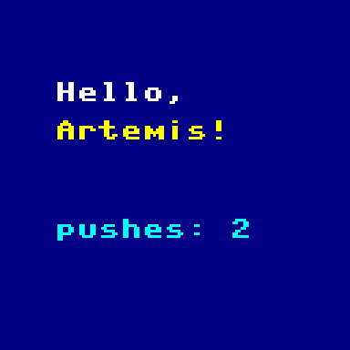

# Artemis Watch emulator

A QEMU-based emulator for the [CircuitMess NASA Artemis Watch 2.0](https://circuitmess.com/products/nasa-artemis-watch-2-0) capable of running its unmodified ESP32-S3 firmware.

<p align="center">
  
</p>

## Features

- Supports CircuitMess's stock firmware (2.0–2.2), MicroPython, and custom ESP-IDF firmware.
- Emulates the dual-core CPU, display, lever, button, LEDs, buzzer, motion sensor, real-time clock, battery and charging, sleep, watchdogs, and flash.
- Provides a Python test API, headless mode, screenshots, and GDB debugging.
- Includes USB tools to inspect, back up, flash, and restore a physical watch.

## Quick start

Requires x86-64 Linux or Windows with WSL 2, and Python 3.10 or later.

```sh
git clone https://github.com/ThatCrispyToast/circuitmess-artemis-emulator
cd circuitmess-artemis-emulator
python3 -m venv .venv && . .venv/bin/activate
pip install .

artemis-emu stock                      # CircuitMess's factory firmware
artemis-emu python examples/hello.py   # a MicroPython program
artemis-emu repl                       # a MicroPython prompt (Ctrl-] quits)
artemis-emu run firmware.bin           # custom firmware
```

QEMU and firmware are downloaded on first use. See the [installation guide](docs/install.md) for system packages, Windows, Nix, and source builds, or the [usage guide](docs/usage.md) for commands and keyboard controls.

## Writing programs

<p align="center">
  
  
  
</p>

MicroPython programs use CircuitMess's `Artemis` library. The programs shown above are in [`examples/`](examples).

Use `--install` to save a script as `main.py` in a persistent flash image and run it at boot:

```sh
artemis-emu python my_program.py --install --flash my_watch.bin
```

## Using a physical watch

Connect the watch over USB. Back up its flash before changing the firmware:

```sh
artemis-emu device info                       # chip, hardware revision, and firmware
artemis-emu device backup my-watch.bin         # save the full flash
artemis-emu device flash micropython          # install this project's MicroPython build
artemis-emu python examples/hello.py --device  # run a program
artemis-emu device restore my-watch.bin        # restore the backup
```

See the [USB setup instructions](docs/usage.md#with-a-real-watch) for serial port permissions and udev rules.

## Testing your code

```python
from artemis_emu import PythonSession, Watch, micropython_firmware

def test_lever_push_lights_an_led():
    with Watch(micropython_firmware()) as watch:
        session = PythonSession(watch)
        session.start(open("examples/hello.py").read())
        watch.wait_until(lambda: (255, 255, 255) in watch.pixels())

        watch.press("select", 0.15)
        watch.wait_until(lambda: watch.leds[0] == 1.0, timeout=2)
```

The API can control buttons, motion, and battery state, and read pixels, LEDs, buzzer state, and serial output. Install pytest with `pip install '.[test]'`.

`PythonSession` also accepts a USB-connected `Device`, so tests that check program output can run on hardware. See the [testing guide](docs/testing.md) for the API.

## Accuracy

Hardware measurements come from one revision 2 watch running this project's MicroPython. Emulator measurements use native Linux. [`tests/test_hardware_comparison.py`](tests/test_hardware_comparison.py) can run on either target.

| Metric | Comparison with hardware |
| --- | --- |
| Execution speed | 17 of 27 MicroPython operations within 3%, all within 11% |
| Idle-core tick wake-up delay | Worst observed: 60 µs in the emulator, 23 µs on hardware |
| UART transmission | Tested at 1,200, 9,600, 115,200, and 921,600 baud; test tolerance is ±3% of nominal transmission time or ±0.4 ms, whichever is larger |
| Registers after MicroPython startup | 1994 of 2004 stable register values match (99.5%); the 10 differences are in the flash controller |
| RTC watchdog resets | Hardware baselines of 200, 400, and 798 ms; test tolerance is ±2% or ±6 ms, whichever is larger |

See [emulation coverage and measurements](docs/accuracy.md) for details.

## Limitations

- Bluetooth and Wi-Fi initialize but cannot transmit or connect. Phone pairing cannot be tested.
- Wi-Fi shutdown takes five seconds instead of milliseconds.
- Memory-heavy workloads run up to 15% faster because flash and PSRAM cache misses are not modeled.
- Peripheral-heavy workloads run up to a third slower in virtual machines, including WSL.
- Matching chip timing uses about one host CPU core while the watch is busy.
- The ULP coprocessor, USB OTG, TWAI, motor PWM, SD host, camera, and LCD interfaces are not emulated.
- ADC voltages are ideal, the buzzer produces a square wave, and power consumption is not modeled.
- Prebuilt QEMU requires x86-64 Linux with glibc 2.34 or later. Other systems require a source build.
- Rebuilding the MicroPython image requires Nix.
- USB access to a physical watch from WSL requires usbipd-win and is untested.

## How it works

The emulator extends [Espressif's QEMU fork](https://github.com/espressif/qemu) with watch peripherals, additional ESP32-S3 components, and CPU timing adjustments. A Python package provides the GUI, CLI, and test API. The Nix flake builds or fetches both firmware images at pinned versions. See the [internals guide](docs/internals.md).

## Credits and license

This project uses [QEMU](https://www.qemu.org), Espressif's fork, and CircuitMess's [stock firmware](https://github.com/CircuitMess/GC_Artemis-Firmware) and [MicroPython](https://github.com/CircuitMess/micropython). Firmware images are not stored in this repository.

This project's original code, examples, documentation, and build scripts are licensed under [GPL-2.0-or-later](LICENSE). Third-party components retain their own licenses; see [third-party notices and sources](THIRD_PARTY.md).

This is an independent project, not affiliated with or endorsed by CircuitMess or NASA.
